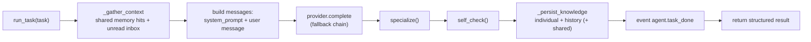

# Agents

AgentHive ships **20 specialized agents**, each built from two parts:

1. a **role class** in `src/agent_hive/agents/roles/<name>.py` (behaviour: prompt, post-processing, self-check);
2. a **YAML configuration** in `configs/agents/<name>.yaml` (identity: capabilities, tools, memory permissions, provider chain).

Role classes are **auto-discovered**: `agents/roles/__init__.py` walks the package, and every `BaseAgent` subclass with a distinct `ROLE` attribute registers itself in `ROLE_REGISTRY`. The runtime (`agents/runtime.py`) is the *only* owner of agent instances — the scheduler, Master Agent and API all go through it, which keeps the dependency graph acyclic.

## BaseAgent contract

`agents/base.py` defines the abstract behaviour every role inherits.

### Constructor state

| Attribute | Source | Purpose |
|---|---|---|
| `config` | YAML (`AgentConfig`) | name, title, description, capabilities, tools, memory flags, providers, params |
| `ROLE` | class attribute | registry key, must match the YAML `role` field |
| `CAPABILITIES` | class attribute | built-in competence list (merged with YAML `capabilities`) |
| `provider` | factory chain | `ProviderChain` with fallback + circuit breaker |
| `params` | YAML `params` | per-agent LLM sampling parameters (e.g. `temperature`) |
| `busy` | runtime flag | True while a task is executing |

### Hooks (role classes may override)

| Hook | Signature | Purpose |
|---|---|---|
| `system_prompt()` | `-> str` | Operational instructions. The base prompt states identity, competences, authorized tools and 5 operating rules (stay in scope, structured JSON `analysis`/`output`/`checklist`, flag uncertainty, report `"blocked"`, never reveal credentials). Roles append role-specific rules. |
| `specialize(task, completion)` | `async` | Role-specific post-processing of the completion. Example: the QA agent normalizes its `checklist` items; the Integration agent normalizes `conflicts`. |
| `self_check(task, text)` | `async -> dict` | Self-verification: fails on empty output, uncovered requirements (from `payload["requirements"]`), or `TODO/FIXME/not implemented/placeholder` markers. Returns `{"passed": bool, "notes": [...]}`. |

### Execution flow (`run_task`)



The returned result dict contains: `agent`, `role`, `title`, `text` (the completion), `data` (first parsed JSON object, if any), `self_check`, `provider`, `model`, `mock`.

### Context gathering

Before prompting the model, the agent gathers:

- **Shared knowledge** — if `memory.shared_access` is enabled, up to 5 memory hits matching the task title prefix are injected (`Shared knowledge: …`).
- **Inbox** — up to 10 unread messages from the persistent bus are injected (`Unread messages: …`) and marked read. Inbox failures are best-effort and never break the task.

### Memory access rules

| Operation | Method | Authorization |
|---|---|---|
| Write individual memory | `remember(key, value)` | requires `memory.individual: true` |
| Read individual memory | `recall(key)` | own memory only |
| Write shared memory | `share_knowledge(key, value)` | requires `memory.shared_write: true` — otherwise the attempt is logged and **dropped** |
| Read shared memory | via context gathering | requires `memory.shared_access: true` |
| Append to history | automatic in `_persist_knowledge` | every task outcome is recorded (`task_result`) |

After every task the agent persists: `task:<id>` in individual memory (summary, provider, mock flag, self-check), a `task_result` history entry, and (if allowed) `result:<task_id>` in shared memory.

### Tools

`use_tool(name, **kwargs)` invokes the permission-controlled registry: the tool must be listed in the agent's YAML `tools`, and `file`/`http` family tools additionally require the global `ENABLE_FILE_TOOLS`/`ENABLE_HTTP_TOOLS` switches. Violations raise `PermissionDenied` (HTTP 403 at the API layer).

### Collaboration methods

| Method | Message kind | Use |
|---|---|---|
| `ask_colleague(colleague, subject, detail)` | `assistance` (priority 2) | ask a peer for help |
| `broadcast(subject, detail)` | `info` to `*` | announce to everyone |
| `challenge_result(colleague, reason)` | `challenge` (priority 1) | contest an insufficiently verified result |
| `report_to_master(subject, detail)` | `response` to `master` | report to the orchestrator |
| `propose(...)` (on the bus) | `proposal` | suggest an approach |

All messages are persisted in the `messages` table and delivered instantly to in-process mailboxes.

## The 20 roles

Each role's `ROLE` / `CAPABILITIES` (from the class) plus YAML description:

| Name | ROLE | CAPABILITIES | Description |
|---|---|---|---|
| `analyst` | `analyst` | analysis, decomposition, requirements | Breaks down user requests into requirements, constraints and sub-problems |
| `api` | `api` | api, contract_design, integration | Designs REST contracts: endpoints, schemas and status codes |
| `architect` | `architect` | architecture, scalability, design | Designs system architecture with components, data flow and trade-offs |
| `automation` | `automation` | automation, deployment, monitoring | Builds idempotent CI/CD pipelines and DevOps automation scripts |
| `database` | `database` | database, optimization, architecture | Designs relational schemas, migrations, indexes and reversible SQL |
| `debugger` | `debugger` | debugging, profiling, evidence | Performs root-cause analysis with ranked, testable hypotheses |
| `designer` | `designer` | design, ux, frontend | Specifies UX/UI layouts, components states and design tokens |
| `documenter` | `documenter` | documentation, synthesis, quality | Writes structured user and technical documentation in markdown |
| `integration` | `integration` | integration, coordination, synthesis | Merges multi-agent contributions into one coherent, conflict-resolved artifact |
| `optimizer` | `optimizer` | optimization, performance, profiling | Proposes algorithmic and resource optimizations with complexity estimates |
| `performance` | `performance` | performance, profiling, benchmarking | Plans profiling campaigns and defines measurable benchmarks and targets |
| `programmer` | `programmer` | programming, refactoring, debugging | Implements production-quality Python solutions as runnable code blocks |
| `qa` | `qa` | quality, validation, review | Runs acceptance checklists and scores deliverables on a 0–1 rubric |
| `researcher` | `researcher` | research, analysis, synthesis | Gathers information, compares options and reports findings with sources |
| `reviewer` | `reviewer` | review, quality, evidence | Reviews artifacts and reports severity-ranked, precisely located findings |
| `security` | `security` | security, threat_modeling, compliance | Models threats and defines concrete, severity-ranked security mitigations |
| `tester` | `tester` | testing, testing_design, quality | Designs test plans and executable pytest suites covering edge cases |
| `ui` | `ui` | frontend, ux, design | Implements accessible, semantic HTML/CSS/JS frontend components |
| `validator` | `validator` | validation, final_check, evidence | Performs final acceptance validation with an explicit accept/reject verdict |
| `verifier` | `verifier` | verification, evidence, consistency | Cross-checks claims for consistency and contradictions with explicit verdicts |

### Example role specializations

- **Programmer** — prompt requires fenced ```python blocks, type hints and docstrings; `self_check` fails if no fenced code block is present.
- **QA** — prompt requires a `checklist` of `{item, passed}` objects plus a numeric `score` in [0, 1]; `specialize` normalizes the checklist; `self_check` fails when the score is missing or out of range.
- **Integration** — prompt requires a `conflicts` list of `{topic, agents, resolution}`; `specialize` normalizes it (agents may arrive as a comma string); `self_check` fails when the key is missing.

## Agent YAML schema reference

File: `configs/agents/<name>.yaml` (one per agent). Validated in `config/loader.py` — unknown agents fail fast.

```yaml
name: analyst                      # required — unique machine id (= file stem)
title: "Analysis Agent"            # human-readable title (default: name)
role: analyst                      # required — must exist in ROLE_REGISTRY
description: "…"                   # mission statement, embedded in the system prompt
capabilities: [analysis, decomposition, requirements]
tools: [summarize, word_count]     # subset of the tool registry
memory:
  individual: true                 # private per-agent memory (default true)
  shared_access: true              # may read shared memory (default false)
  shared_write: false              # may write shared memory (default false)
providers:                         # ordered fallback chain
  - type: openai_compatible
    model: gpt-4o-mini
    base_url_env: OPENAI_BASE_URL  # env var *name* holding the base URL (optional)
    api_key_env: OPENAI_API_KEY    # env var *name* holding the key — never the secret
    params: {temperature: 0.3}
  - type: ollama
    model: llama3.2
    params: {temperature: 0.3}
  - type: mock                     # deterministic fallback, tagged [MOCK]
params: {}                         # forwarded to provider.complete()
```

| Field | Required | Notes |
|---|---|---|
| `name` | ✅ | Must equal the filename stem; used as mailbox + registry key |
| `title` | — | Defaults to `name` |
| `role` | — | Defaults to `name`; **must** match a role class or startup fails with `ConfigError` |
| `description` | — | Empty by default; injected into `system_prompt()` |
| `capabilities` | — | Merged with the class `CAPABILITIES` for matching |
| `tools` | — | Permission list for `ToolRegistry.run()` |
| `memory` | — | Three booleans, see above |
| `providers` | — | Ordered list; empty → single `mock` provider |
| `params` | — | Sampling parameters passed to every provider call |

## How agents collaborate

1. **Shared mission context.** The Master writes `mission:<id>` into shared memory at kickoff; every agent with `shared_access` reads matching shared knowledge before each task.
2. **Inbox traffic.** Assistance requests, proposals, challenges and reviews arrive as persistent messages; each agent drains its inbox (10 most recent unread) into its prompt context.
3. **Result sharing.** Agents with `shared_write` publish `result:<task_id>` summaries; collaborators and the Integration Agent consume them.
4. **Cross-review (Mode B).** The `verifier` reviews all contributions for contradictions, gaps and unverified claims, and can `challenge()` questionable results.
5. **Conflicts are surfaced.** Failed self-checks, failed tasks and validator rejections are collected by the Master's conflict detector and reported in the mission report; the Integration Agent must resolve conflicts in favor of verified content.

## How agent selection works

Selection lives in `AgentRuntime` (`agents/runtime.py`):

- **Capability matching.** `best_agent_for(capabilities_hint)` scores each candidate by the size of the intersection between the hint and the agent's capabilities (class `CAPABILITIES` ∪ YAML `capabilities`); the highest-scoring candidate wins. The scheduler passes the task's `payload.capabilities_hint` (set by the Master from the workstream capability).
- **Round robin fallback.** When no candidate matches the hint, selection rotates through all agents so simple tasks distribute evenly.
- **Direct assignment.** The Master pre-assigns agents for workstreams and pipeline tasks (cross-review → `verifier`, integration → `integration`, QA → `qa`, validation → `validator`) by resolving the pipeline capability to the first agent holding it (`agents_with_capability`).
- **Busy flag.** `exclude_busy=True` filters out agents currently executing a task (used by direct-execution paths; the scheduler itself relies on the concurrency semaphore instead).
