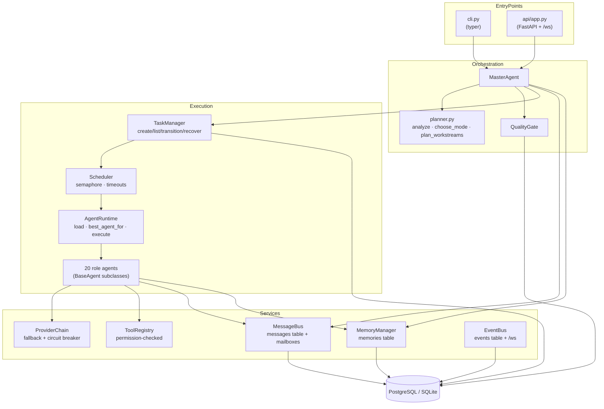
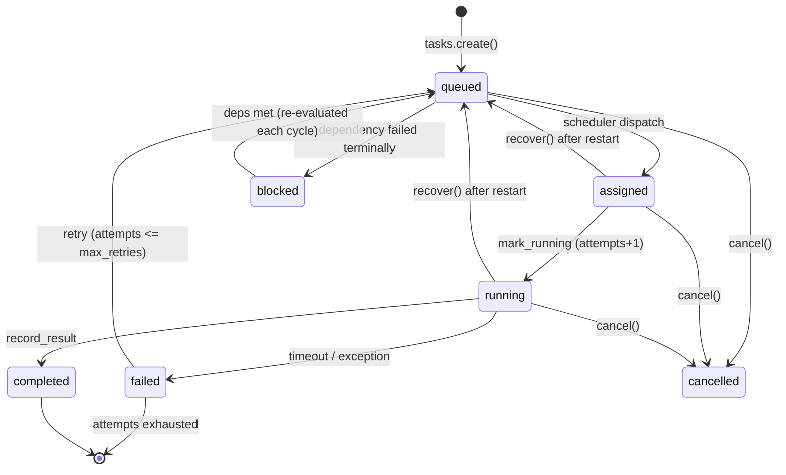
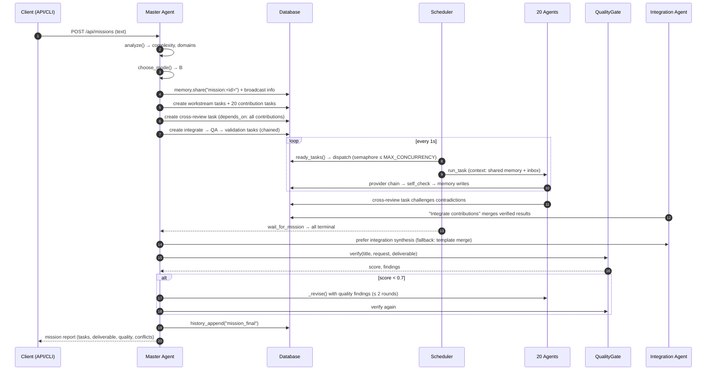

# Architecture

AgentHive is an asynchronous, database-backed multi-agent system. Every subsystem is an independent layer with an acyclic dependency graph; a single `Hive` instance per process composes them.

## Layered architecture

| Layer | Module | Responsibility |
|---|---|---|
| Configuration | `config/settings.py`, `config/loader.py` | Environment-driven settings (12-factor) + YAML system/agent configs |
| Core | `core/errors.py`, `core/events.py`, `core/ids.py`, `core/logging.py` | Exception hierarchy, async event bus with audit log, IDs, logging |
| Database | `db/base.py`, `db/models.py` | SQLAlchemy 2 async engine; tables: `agents`, `tasks`, `messages`, `memories`, `events`, `verifications` |
| Providers | `providers/factory.py`, `base.py`, `openai_compat.py`, `ollama.py`, `mock.py` | Per-agent LLM fallback chains with circuit breaker |
| Memory | `memory/manager.py` | 3-tier persistent memory (individual / shared / history) |
| Communication | `communication/bus.py` | Persistent message bus + in-process asyncio mailboxes |
| Tasks | `tasks/manager.py`, `tasks/scheduler.py` | Task DAG state machine; concurrent dispatcher with retries/timeouts |
| Tools | `tools/registry.py`, `tools/builtin.py` | Permission-controlled tool registry + built-in tools |
| Agents | `agents/base.py`, `agents/runtime.py`, `agents/roles/` | BaseAgent contract, runtime registry, 20 role classes |
| Orchestrator | `orchestrator/master.py`, `planner.py`, `quality.py` | Master Agent, complexity analysis, quality gate |
| API | `api/app.py`, `api/schemas.py` | FastAPI REST + WebSocket |
| CLI | `cli.py` | Typer operator interface |

### Component diagram



### Composition root (`hive.py`)

`Hive` owns every subsystem and is constructed in dependency order:

```text
settings/system-config ──▶ db ──▶ memory ──┐
                                           ├─▶ runtime ─▶ scheduler ─▶ master
event-bus ─▶ task-manager ─────────────────┘
```

`startup()` is **idempotent** and ordered: schema creation → agent loading → runtime heartbeat → scheduler start → recovery of interrupted tasks. `shutdown()` reverses it (scheduler → runtime → event bus → engine disposal). The API server creates one `Hive` in its lifespan handler; the CLI creates a short-lived one per command.

## Master Agent walkthrough

`orchestrator/master.py` implements the 10 responsibilities of the system specification:

1. **Receive & understand any user request.** `handle_mission(text, mode, title)` validates the text is non-empty, derives a title (first 70 chars) and a `mission_id`.
2. **Analyze complexity.** `planner.analyze()` computes a 0..1 score from request length (up to +0.25), domain breadth (detected domains from keyword tables, +0.05 per domain up to 6), multi-part structure (+0.12 for numbered/bulleted items or repeated "and then"), and big-mission signals (+0.15 for "entire/complete/full/end-to-end"). It also extracts up to 15 requirement keywords.
3. **Choose the operating mode.** `choose_mode()` picks **A** below `simple_threshold` (0.25), **C** below `adaptive_threshold` (0.55), otherwise **B**. A user-forced mode overrides the heuristic (and is validated against `A|C|B`).
4. **Decompose into subtasks.** `plan_workstreams()` creates one workstream per detected domain (capability-oriented), or a single "Single-agent execution" workstream in Mode A. Adaptive missions below `adaptive_min_agents` (3) get extra verification/quality workstreams.
5. **Pick the most suitable agents.** Mode A: one capability-matched agent. Mode C: one agent per workstream domain, plus `verifier` and `qa`, capped to at least `adaptive_min_agents`. Mode B: **all 20 agents**.
6. **Assign tasks.** `_delegate()` creates the task DAG in the `tasks` table with `depends_on` links (Mode B also creates a distinct "Contribution from <role>" task for every roster agent not already assigned a workstream).
7. **Monitor progress continuously.** The Master awaits `scheduler.wait_for_mission(mission_id, max_wait_s=1800)` which polls until every mission task is terminal (completed / failed / cancelled).
8. **Detect errors, conflicts and insufficient results.** `_detect_conflicts()` collects: agents whose own `self_check` failed (`unverified_output`), failed tasks (`failed_task`), and validator rejections (`rejected_by_validator`). The cross-review task in Mode B also challenges questionable results.
9. **Request revisions.** If the quality gate fails, `_revise()` sends the draft + quality findings back to the producing (or integration) agent via `runtime.run_direct`, up to **2 revision rounds** (`MAX_REVISION_ROUNDS`); a failed revision keeps the previous draft.
10. **Verify & integrate the final result.** `_integrate()` prefers the Integration Agent's completed synthesis, falls back to a deterministic template merge; `QualityGate.verify()` scores the deliverable and the Master **refuses to deliver below `qa_required_score` (0.7)** — instead revising. The mission report is returned with tasks, outcome, quality findings and revision rounds.

**Delegation-first design:** the Master executes work itself only when no specialized agent can. Integration synthesis uses the *integration agent's provider*, not the master's.

## Task lifecycle

`tasks/manager.py` state machine:



- Terminal statuses: `completed`, `failed`, `cancelled`.
- Every task carries `attempts`, `max_retries` (default 2), `timeout_s` (default 120) and `depends_on` (validated at creation — unknown dependencies raise `DependencyError`).
- `ready_tasks()` returns queued/blocked tasks whose dependencies are **all completed**; a dependency that failed terminally marks the dependent `blocked` for triage.

## Scheduler guarantees

`tasks/scheduler.py`:

| Guarantee | Mechanism |
|---|---|
| Bounded concurrency | `asyncio.Semaphore(MAX_CONCURRENCY)` (default 8) around each task execution |
| Per-task timeout | `asyncio.wait_for(execute, timeout=task.timeout_s)`; timeout records a failure |
| Automatic retries | `TaskManager.record_failure` re-queues with `agent_name=None` while `attempts <= max_retries` |
| Re-assignment | Retried tasks lose their agent binding so a different agent can take them |
| Poll loop | Every `scheduler_interval` (1.0 s) the loop dispatches all currently-ready tasks |
| Crash safety | `recover()` resets orphaned `running`/`assigned` tasks to `queued` on startup or via `agent-hive recover` |
| Mission monitor | `wait_for_mission` polls every 2 s until all mission tasks are terminal (Master uses a 1800 s budget) |
| Ordered selection | `best_agent_for` scores candidates by capability match against the task's `capabilities_hint`, falls back to round robin |

## Quality gate

`orchestrator/quality.py` scores the deliverable from 1.0 downward and persists a `verifications` row + a history memory entry + a `quality.verified` event:

| Check | Weight (deduction on failure) | What it does |
|---|---|
| completeness | −0.40 | Deliverable must be substantive (≥ 80 chars) |
| requirements | −0.25 | Keyword coverage of title+description must reach 40% (configurable via `qa_requirement_check`) |
| code (per block) | −0.30 | Every fenced ```python block is AST-parsed and compiled — **never executed** |
| secrets | −0.50 | `secret_scan` finds hard-coded API keys, passwords, bearer tokens, private keys |
| markers | −0.15 | No `TODO` / `FIXME` / `not implemented` / `placeholder` leftovers |

**Score ≥ `qa_required_score` (0.7)** passes. On failure the Master runs up to 2 revision rounds feeding the findings back to an agent. Findings are returned in the mission report (`report.quality.findings`).

## Sequence: a Mode B mission



## Design decisions

- **Acyclic dependencies.** The composition order (`settings → db → memory → task-manager → runtime → scheduler → master`) is a DAG. Agents never import orchestration code; the runtime is the single owner of agent instances, and `agents/roles/__init__.py` discovers role classes dynamically so adding an agent requires no runtime change.
- **Delegation-first.** The Master orchestrates, it does not execute. Specialized work always goes to the agent with matching capabilities; integration synthesis uses the integration agent's provider.
- **No vendor lock-in.** All LLM access goes through the `LLMProvider` interface and per-agent fallback chains. Any OpenAI-compatible server (OpenAI, Azure gateways, vLLM, LM Studio, LiteLLM, Groq, Together, DeepSeek), any Ollama instance, or the deterministic mock can serve every agent, per agent.
- **Database as source of truth.** Tasks, messages, memory and verifications are rows, not in-memory state — restarts are safe, recovery is a status reset, and the same models run on PostgreSQL (production) and SQLite (tests/local).
- **Verification before delivery.** Nothing reaches the client without passing the quality gate (or after its two revision rounds, with the gate verdict reported honestly).

---

# Universal AI Platform architecture (addendum)

The orchestration core described above is now reachable through a universal
connectivity layer. Dependency graph (acyclic, extends the core one):

```text
settings ──▶ db ──▶ memory ──┐
                             ├─▶ runtime ─▶ scheduler ─▶ master
event-bus ─▶ task-manager ───┘
                             │
universal_memory ────────────┤
mcp/tools (18 tool specs) ───┤
                             │
gateway ──▶ mcp.tools.call ──┘          # single capability surface
   ▲
   ├── connectors/openai_api   (/v1/*)
   ├── connectors/ollama_api   (/api/chat, /api/generate, /api/tags)
   ├── connectors/ws           (/ws/universal)
   ├── mcp/http                (POST /mcp, Streamable HTTP)
   ├── mcp/stdio               (agent-hive mcp)
   └── api/app REST            (/api/universal/*)

security: middleware (auth+rate limit) → tokens/RBAC → audit
selfheal: bounded loop → safe-stop callback = hive.shutdown
```

## Module responsibilities

| Module | Responsibility |
| --- | --- |
| `mcp/tools.py` | The 18 tool specs (name, description, JSON schema, scope, timeout, handler); registry validates → authorizes → times → wraps errors into `{ok, data\|error}` |
| `mcp/server.py` | JSON-RPC 2.0 core: initialize/version negotiation, session objects, tools/list, tools/call with MCP `isError` semantics, protocol error codes |
| `mcp/http.py` | Streamable HTTP transport: session header, 202 for notifications, optional SSE, DELETE = session end |
| `mcp/stdio.py` | Local transport: line-delimited JSON-RPC; locally-trusted session |
| `universal_memory/` | Cross-client store: 5 memory types, namespace isolation, dedup + versioning, TTL purge, blended full-text/vector search (hashed 128-dim embeddings) |
| `gateway/` | The one front door: sanitize → injection guard → rate limit → mission translation → execution → history persistence → structured response; semaphore + timeout + cancellation + resume |
| `security/` | Token lifecycle (hash-only storage, revoke/rotate), RBAC scope sets, sliding-window rate limiter, input/output sanitization, prompt-injection heuristics, audit writer |
| `connectors/` | Server-side protocol adapters; all of them call the gateway/tool registry so behaviour is identical across clients |
| `providers/anthropic.py`, `providers/gemini.py` | Native adapters for the two major non-OpenAI-compatible APIs (documented wire differences in the module docstrings) |
| `providers/presets.py` | Verified endpoint presets: OpenAI, Claude, Gemini, Z.ai, DeepSeek, Qwen, Mistral, Grok, Perplexity, OpenRouter + Ollama, LM Studio, llama.cpp, vLLM, LocalAI, HuggingFace |
| `github_integration/` | Mode-gated GitHub REST client (`read_only` → `autonomous`), confirmation gates for destructive ops, local security scan |
| `selfheal/` | Continuous bounded self-checks (DB, scheduler, agents, memory, events) with remediation retry caps, per-cycle budget and safe-stop |

## Invariants worth knowing

1. **One capability surface.** Every connector exposes exactly the 18
   registry tools; adding a 19th tool is a single registration in
   `mcp/tools.py` — clients discover it via `tools/list` /
   `GET /api/universal/tools`.
2. **One memory.** Missions, tool calls and gateway exchanges persist to
   `universal_memory`; the cross-client continuation flow (create with A →
   resume with B) is a verified test, not an aspiration.
3. **Trust is explicit.** Local-trust ↔ enforced mode is a live property of
   token state, identical for HTTP middleware, MCP sessions and the gateway.
4. **Nothing runs unbounded.** Tools, gateway requests, remediation loops
   and rate windows all have hard budgets.
