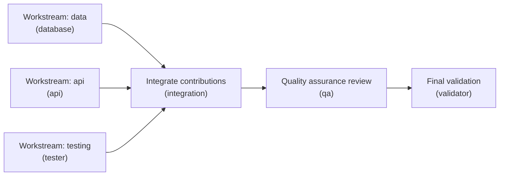
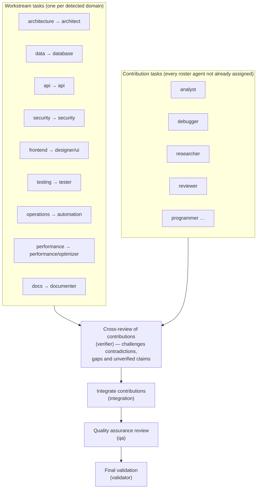

# Worked Examples

Three end-to-end missions showing exactly what AgentHive produces — with the task DAG shapes the Master Agent actually creates, the (trimmed) mission report JSON, and API/CLI/Python-SDK variants for each.

> All examples assume the server is running (`agent-hive start`) with `ALLOW_MOCK=true`, so they work with zero configuration. In mock mode every deliverable is honestly tagged `[MOCK]`; with a real provider configured, the same pipelines produce real AI output.

---

## Example 1 — Mode A (simple): one agent, one task

### Request

```bash
curl -X POST http://127.0.0.1:8000/api/missions \
  -H "Content-Type: application/json" \
  -d '{"text": "Write a fibonacci function with unit tests", "title": "Fibonacci"}'
```

**What the Master does:**

1. `analyze()` → complexity ≈ **0.05** (short request, 2 domains detected: `code`, `testing`), keywords `["fibonacci", "function", "tests"]`.
2. `choose_mode()` → **A** (0.05 < `simple_threshold` 0.25).
3. `plan_workstreams()` → a single workstream *"Single-agent execution"* with capability `programming` (first capability of the `code` domain).
4. Agent selection → `programmer` (holds `programming`).
5. DAG: **1 task**, no pipeline. The single result is used directly as the deliverable (`_integrate` in Mode A takes the completed task's output; no integration/QA/validation tasks are created).
6. Quality gate on the deliverable → reported in the response.

### Report (trimmed)

```json
{
  "mission_id": "3a91c0de5f274b8e9c1d2f3a4b5c6d70",
  "title": "Fibonacci",
  "mode": "A",
  "complexity": 0.05,
  "domains": ["code", "testing"],
  "agents": ["programmer"],
  "tasks": [
    { "id": "b1e4c2f8…", "title": "Single-agent execution", "agent": "programmer",
      "status": "completed", "attempts": 1 }
  ],
  "outcome": { "completed": 1, "failed": 0, "cancelled": 0, "total": 1 },
  "deliverable": "[MOCK] Structured draft deliverable for: Write a fibonacci function with unit tests …",
  "deliverable_by": "programmer",
  "conflicts": [],
  "quality": {
    "passed": true, "score": 0.95,
    "findings": [
      { "check": "completeness", "ok": true, "detail": "842 chars" },
      { "check": "requirements", "ok": true, "detail": "keyword coverage 100% (3/3)" },
      { "check": "secrets", "ok": true, "detail": "clean" },
      { "check": "markers", "ok": true, "detail": "none" }
    ]
  },
  "revision_rounds": 0,
  "completed_at": "2026-11-15T10:24:31+00:00"
}
```

### CLI variant

```bash
agent-hive run "Write a fibonacci function with unit tests" --json
```

### Python SDK variant

```python
import asyncio
from agent_hive.hive import Hive

async def main():
    hive = Hive()
    await hive.startup()
    try:
        report = await hive.run_mission(
            "Write a fibonacci function with unit tests",
            title="Fibonacci",
        )
        print(report["mode"], report["quality"]["score"], report["deliverable"])
    finally:
        await hive.shutdown()

asyncio.run(main())
```

---

## Example 2 — Mode C (adaptive): 3 workstreams + full pipeline

### Request

```bash
curl -X POST http://127.0.0.1:8000/api/missions \
  -H "Content-Type: application/json" \
  -d '{
    "text": "Design a small project management web application with a database, a REST API and unit tests",
    "mode": "C",
    "title": "Project tracker"
  }'
```

**What the Master does:**

1. `analyze()` → complexity ≈ **0.16**; domains detected: `data` ("database"), `api` ("REST API"), `testing` ("unit tests").
2. Mode forced to **C** via the request (`"mode": "C"`); unforced it would stay A at 0.16 — this is exactly how you try out adaptive mode on a small request.
3. `plan_workstreams()` → 3 workstreams (one per domain), already ≥ `adaptive_min_agents` (3), so no extra verification/quality workstreams.
4. Agent selection: one owner per workstream plus the pipeline roles → `database`, `api`, `tester`, `verifier`, `qa`.
5. DAG: 3 workstream tasks → *Integrate contributions* (`integration`) → *Quality assurance review* (`qa`) → *Final validation* (`validator`).



### Report (trimmed)

```json
{
  "mission_id": "7c42d9e18ab04f6c8d1e2f3a4b5c6d71",
  "title": "Project tracker",
  "mode": "C",
  "complexity": 0.16,
  "domains": ["data", "api", "testing"],
  "agents": ["database", "api", "tester", "verifier", "qa"],
  "tasks": [
    { "id": "d11…", "title": "Workstream: data",    "agent": "database", "status": "completed", "attempts": 1 },
    { "id": "d22…", "title": "Workstream: api",     "agent": "api",      "status": "completed", "attempts": 1 },
    { "id": "d33…", "title": "Workstream: testing", "agent": "tester",   "status": "completed", "attempts": 1 },
    { "id": "d44…", "title": "Integrate contributions",   "agent": "integration", "status": "completed", "attempts": 1 },
    { "id": "d55…", "title": "Quality assurance review",  "agent": "qa",          "status": "completed", "attempts": 1 },
    { "id": "d66…", "title": "Final validation",          "agent": "validator",   "status": "completed", "attempts": 1 }
  ],
  "outcome": { "completed": 6, "failed": 0, "cancelled": 0, "total": 6 },
  "deliverable": "… integrated deliverable (merged database schema + API contract + test plan) …",
  "deliverable_by": "integration",
  "conflicts": [],
  "quality": { "passed": true, "score": 0.85, "findings": ["…"] },
  "revision_rounds": 0
}
```

Note the dependency effect: the integration task waits until all three workstreams are `completed` (`ready_tasks()` re-evaluates dependencies every scheduler cycle); QA waits for integration; validation waits for QA.

### CLI / SDK variants

```bash
agent-hive run "Design a small project management web application with a database, a REST API and unit tests" --mode C --title "Project tracker" --json
```

```python
report = await hive.run_mission(
    "Design a small project management web application with a database, "
    "a REST API and unit tests",
    mode="C",
)
```

(This is the same mission exercised by `python scripts/smoke_test.py` in mock mode.)

---

## Example 3 — Mode B (collective): all 20 agents, cross-review pipeline

### Request

```bash
curl -X POST http://127.0.0.1:8000/api/missions \
  -H "Content-Type: application/json" \
  -d '{
    "text": "Build a complete end-to-end project management platform:\n1. System architecture with scalability design\n2. Relational database schema with migrations\n3. REST API with authentication and security\n4. Frontend interface with accessible design\n5. Comprehensive test suite with coverage\n6. CI/CD deployment pipeline\n7. Performance benchmarks and optimization\n8. User and technical documentation",
    "title": "PM platform"
  }'
```

**What the Master does:**

1. `analyze()` → complexity ≈ **0.60** (long multi-part request, 9 domains — architecture, data, api, security, frontend, testing, operations, performance, docs — plus the "complete" big-mission signal and numbered-list structure). **0.60 ≥ `adaptive_threshold` (0.55) → Mode B**, no forcing needed.
2. Agent selection → **all 20 agents** participate.
3. DAG shape (actually created by `_delegate`):



4. Every roster agent not owning a workstream gets its own *"Contribution from \<role>"* task, so all 20 agents do real, distinct work in the same mission.
5. The cross-review task depends on **all** workstream + contribution tasks; integration depends on those *plus* the review; QA on integration; validation on QA.
6. Total DAG: ~9 workstreams + ~11 contributions + review + integrate + QA + validation ≈ **24 tasks**, dispatched by the scheduler within `MAX_CONCURRENCY`.

### Report (trimmed)

```json
{
  "mission_id": "5b83e2f19cd04a7b8e2f1a3b4c5d6e72",
  "title": "PM platform",
  "mode": "B",
  "complexity": 0.6,
  "domains": ["architecture", "data", "api", "security", "frontend", "testing", "operations", "performance", "docs"],
  "agents": ["analyst", "api", "architect", "automation", "database", "debugger", "designer", "documenter", "integration", "optimizer", "performance", "programmer", "qa", "researcher", "reviewer", "security", "tester", "ui", "validator", "verifier"],
  "tasks": [
    { "id": "e01…", "title": "Workstream: architecture", "agent": "architect", "status": "completed", "attempts": 1 },
    { "id": "e02…", "title": "Workstream: data",         "agent": "database",  "status": "completed", "attempts": 1 },
    { "id": "e03…", "title": "Contribution from programmer (programmer)", "agent": "programmer", "status": "completed", "attempts": 1 },
    { "id": "e04…", "title": "Contribution from security (security)",     "agent": "security",   "status": "failed",    "attempts": 3 },
    { "id": "e20…", "title": "Cross-review of contributions", "agent": "verifier",   "status": "completed", "attempts": 1 },
    { "id": "e21…", "title": "Integrate contributions",       "agent": "integration","status": "completed", "attempts": 1 },
    { "id": "e22…", "title": "Quality assurance review",      "agent": "qa",         "status": "completed", "attempts": 1 },
    { "id": "e23…", "title": "Final validation",              "agent": "validator",  "status": "completed", "attempts": 1 }
  ],
  "outcome": { "completed": 23, "failed": 1, "cancelled": 0, "total": 24 },
  "deliverable": "… integrated platform design: architecture, schema, API contract, frontend plan, test strategy, CI/CD, benchmarks, documentation …",
  "deliverable_by": "integration",
  "conflicts": [
    { "type": "failed_task", "agent": "security", "detail": "ProviderError: All providers failed: …" }
  ],
  "quality": { "passed": true, "score": 0.78, "findings": ["…"] },
  "revision_rounds": 1,
  "completed_at": "2026-11-15T11:02:45+00:00"
}
```

Honest-behaviour notes visible in this report:

- A failed task is **not hidden**: the security agent's task failed after its retries and shows up both in `tasks` and as a `conflicts` entry (`failed_task`).
- `revision_rounds: 1` means the first quality-gate verdict was below 0.7 and the Master requested one revision before passing.
- The integration agent's synthesis is preferred as the deliverable; if it had not completed, a deterministic template merge would have been used instead (and attributed to `master`).

### CLI / SDK variants

```bash
agent-hive run "Build a complete end-to-end project management platform: architecture, database, REST API, frontend, security, tests, CI/CD, performance and documentation" --title "PM platform" --json
```

```python
report = await hive.run_mission(
    "Build a complete end-to-end project management platform: architecture, "
    "database, REST API, frontend, security, tests, CI/CD, performance and documentation",
    title="PM platform",
)
```

---

## Observing the runs

- **WebSocket**: connect to `ws://127.0.0.1:8000/ws` and watch `mission.started`, `task.created`, `task.running`, `task.completed`, `agent.task_done`, `quality.verified`, `mission.completed` events in real time.
- **Task view**: `GET /api/tasks?mission_id=<id>` shows the DAG; `GET /api/tasks/{id}` shows each task's stored result, attempts and error.
- **Memory**: `GET /api/memory/shared?q=mission` shows the mission context the Master published; `GET /api/memory/history` shows the append-only record of every task result and quality verdict.
- **Messages**: `GET /api/messages` shows the bus traffic, including the Master's kickoff broadcast.

## Python SDK — full in-process session

```python
import asyncio
from agent_hive.hive import Hive

async def main():
    hive = Hive()                 # owns every subsystem (one instance per process)
    await hive.startup()          # schema → agents → heartbeat → scheduler → recovery
    try:
        # 1. full mission through the Master Agent
        report = await hive.run_mission(
            "Design a small project management web application with a database, "
            "a REST API and unit tests",
            mode="C",
        )
        print(f"mode={report['mode']} score={report['quality']['score']:.2f}")

        # 2. inspect the system like the API does
        print(hive.status())
        for agent in hive.runtime.describe():
            print(agent["name"], agent["capabilities"])

        # 3. ad-hoc single-agent execution (no task queue)
        result = await hive.runtime.run_direct(
            "documenter",
            "Summarize the mission",
            payload={"requirements": ["three bullet points"]},
            description="Summarize the previous deliverable.",
        )
        print(result["text"])

        # 4. maintenance: prune historical memory
        print(await hive.memory.prune())
    finally:
        await hive.shutdown()     # scheduler → runtime → events → engine

asyncio.run(main())
```

`run_direct` bypasses the queue for one-shot requests; everything else (memory writes, self-checks, provider fallback, events) behaves exactly as in a scheduled task.
