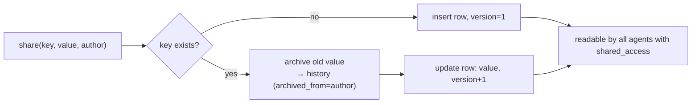

# Memory System

AgentHive's memory is a single `memories` table driven by `MemoryManager` (`src/agent_hive/memory/manager.py`), organized into **three tiers** and kept clean through versioned upserts, automatic archival and explicit pruning.

## Overview

| Tier | Scope | `agent_name` | Writes | Typical keys |
|---|---|---|---|---|
| **individual** | one agent | set | always allowed if `memory.individual` | `task:<task_id>` |
| **shared** | whole project | `NULL` | only agents with `memory.shared_write` (or the Master / API) | `mission:<mission_id>`, `result:<task_id>` |
| **history** | append-only audit | `NULL` | system + agents | `task_result:<rand>`, `quality_verdict:<rand>`, `mission_final:<rand>` |

Uniqueness: a **`uq_memory_key`** constraint on `(agent_name, scope, key)` guarantees exactly one canonical entry per key in the individual and shared tiers; history entries carry a random suffix so they never collide.

## Tier 1 — Individual memory

Private notes per agent. Always authorized (when enabled in the agent's YAML):

```python
await agent.remember("task:b1e4…", {"title": "...", "summary": "...", "self_check": {...}})
entry = await agent.recall("task:b1e4…")   # entry.value or None
```

Automatic behavior: after every completed task the agent stores a `task:<id>` record containing the task title, a 500-char output summary, the provider used, whether the output was mock, and the self-check verdict.

Read from the API:

```bash
curl "http://127.0.0.1:8000/api/memory/individual?agent=programmer"
```

## Tier 2 — Shared memory

Project-wide knowledge that authorized agents read into their context before each task, and authorized writers publish to.

### Versioned upsert

`MemoryManager.share(key, value, author)`:

- **Key exists** → the row is updated in place, `version += 1`, and — crucially — the **previous value is automatically archived into history** with `archived_from: <author>`. Nothing is silently overwritten.
- **Key is new** → a row is created with `version: 1`, `agent_name: NULL`.



Example lifecycle of `mission:<id>`: the Master creates it at kickoff (`version 1`); nothing else overwrites that key, while `result:<task_id>` keys accumulate as agents report.

### Authorization

Agents without `memory.shared_write: true` have their write attempts **logged and dropped** (`BaseAgent.share_knowledge`), never applied. The Master Agent and the REST API (`POST /api/memory/shared`) write with their own authority.

## Tier 3 — History (append-only)

`MemoryManager.history_append(key, value, actor)` records every important outcome forever (until retention pruning). Keys are made unique with a random suffix (`f"{key}:{new_id()[:8]}"`), and each entry is stamped with `actor` and `recorded_at`.

What is recorded automatically:

| Actor | When | Key |
|---|---|---|
| every agent | task completed | `task_result` (task id, agent, role, title, 1000-char outcome, self-check pass) |
| QualityGate | every verification | `quality_verdict` (title, score, passed, findings) |
| Master Agent | mission finished | `mission_final` (mission id, title, mode, quality score, passed) |
| shared upserts | shared update overwrote a value | `<key>` with `archived_from` |

Read from the API:

```bash
curl "http://127.0.0.1:8000/api/memory/history?limit=50"
```

## Versioning & dedup rules

- Writes to individual/shared are **upserts keyed by `(agent, scope, key)`** — one canonical entry per key with a monotonically increasing `version` counter. Re-writing the same key never creates duplicates.
- The full value is replaced on update (last-write-wins per key); the *previous* value survives in history for shared keys.
- Integrity violations surface as `MemoryError_` (constraint violation) instead of partial writes.

## Retention & pruning

`MemoryManager.prune()` removes obsolete history. Settings (`.env`):

| Setting | Default | Meaning |
|---|---|---|
| `MEMORY_RETENTION_DAYS` | 90 | history entries older than this are deleted |
| `MEMORY_MAX_VERSIONS` | 20 | per logical key prefix, only the newest N history rows are kept |

`prune()` returns `{"history_expired": n, "history_capped": m}`.

> **Note:** `prune()` is currently a *manual* maintenance operation — the runtime does not schedule it automatically. Run it periodically, e.g. from a script or cron job:

```python
import asyncio
from agent_hive.hive import Hive

async def main():
    hive = Hive()
    await hive.startup()
    try:
        print(await hive.memory.prune())
    finally:
        await hive.shutdown()

asyncio.run(main())
```

## Conflict & obsolescence strategy

- **Superseded knowledge** is never destroyed silently: shared updates archive their predecessor to history before mutating the row.
- **Stale reads are bounded**: agents gather at most 5 shared hits per task (most recently updated first), and search results are ordered by `updated_at DESC`.
- **Contradictions between agents** are handled at the mission level, not in memory: the cross-review task (Mode B) challenges questionable results, and the Master's conflict detector reports `unverified_output`, `failed_task` and `rejected_by_validator` conflicts so the Integration Agent can resolve them in favor of verified content.

## Searching memory

`MemoryManager.search(query, scope, agent, limit)` performs substring matching over keys **and** JSON-serialized values (case-insensitive), ordered by recency:

```bash
curl "http://127.0.0.1:8000/api/memory/shared?q=fibonacci"
curl "http://127.0.0.1:8000/api/memory/individual?agent=qa&q=checklist"
```

Agents use the same mechanism internally during context gathering (`search(task_title_prefix, scope="shared", limit=5)`).

## Persistence

- Storage is the `memories` table (SQLAlchemy 2 async models in `db/models.py`), identical schema on **PostgreSQL** (`postgresql+asyncpg://…`, production) and **SQLite** (`sqlite+aiosqlite://…`, tests/local).
- All writes go through the async session factory with commit/rollback handling; history archival happens in the same transaction as the shared update, so a version bump and its archive are atomic.
- The database file/data lives under `data/` for SQLite (`DATABASE_URL` controls it); back up PostgreSQL with standard tooling (`pg_dump`) — see [operations.md](operations.md).
