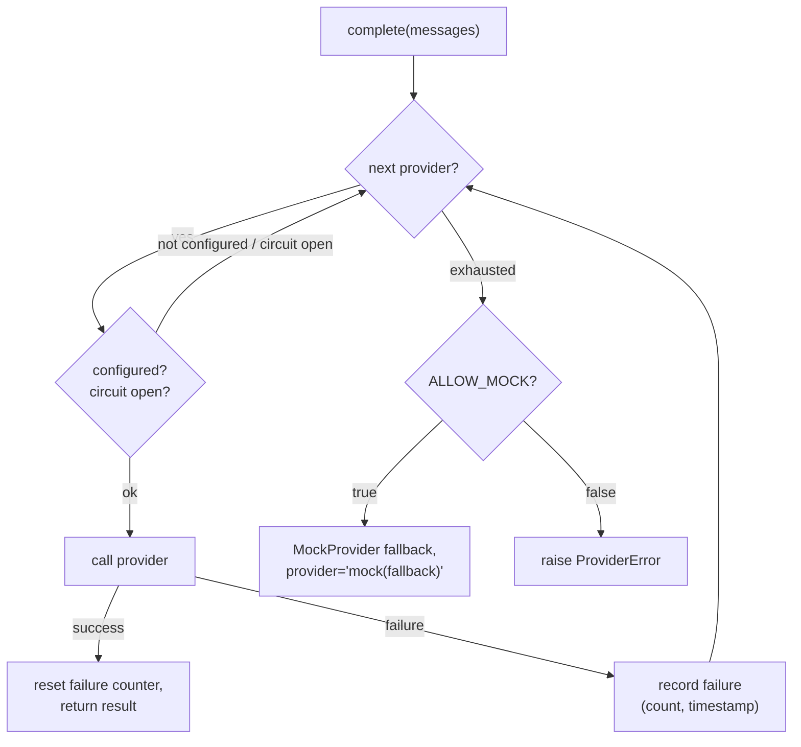

# Providers

Every agent talks to LLMs through an ordered **fallback chain** of providers built from its YAML config. This makes the system vendor-neutral: each agent independently decides which backends to try, in which order, and what to do when everything fails.

## Provider types

| Type | Module | Endpoint | `configured()` semantics |
|---|---|---|---|
| `openai_compatible` | `providers/openai_compat.py` | `POST {base_url}/chat/completions` | Unusable (skipped) when the base URL is the default `api.openai.com` **and** no API key is present in the environment. Any other base URL (vLLM, LM Studio, LiteLLM, Groq, Together, DeepSeek, Azure gateways) is considered configured without a key. |
| `ollama` | `providers/ollama.py` | `POST {base_url}/api/chat` | Always considered configured; fails per-call if the server is unreachable. Default URL `http://localhost:11434` (env `OLLAMA_BASE_URL`), default model `llama3.2`, 300 s timeout. |
| `mock` | `providers/mock.py` | — (no network) | Always configured. Deterministic, hash-seeded template output, **always tagged `[MOCK]`**, `mock: true` in every result. |

Health probes (used by `agent-hive diagnose` and `scripts/diagnose.py`, 10 s timeout, informational only):

- `openai_compatible` → `GET {base_url}/models` (status < 500 ⇒ healthy)
- `ollama` → `GET {base_url}/api/tags`

## Per-agent fallback chains

Defined in each `configs/agents/<name>.yaml`, tried strictly in order — **first success wins**:

```yaml
providers:
  - type: openai_compatible
    model: gpt-4o-mini
    base_url_env: OPENAI_BASE_URL
    api_key_env: OPENAI_API_KEY
    params: {temperature: 0.3}
  - type: ollama
    model: llama3.2
    params: {temperature: 0.3}
  - type: mock
```

Built by `build_provider_chain()` (`providers/factory.py`); an agent with no `providers` list gets a single mock provider. The effective chain is visible in the API (`GET /api/agents` → `providers`) and CLI (`agent-hive agents`).

## Environment variable resolution

YAML files contain **names of environment variables, never secret values**:

| YAML field | Meaning | Resolution |
|---|---|---|
| `api_key_env` | env var holding the API key | Read at construction; if absent the client sends no `Authorization` header (fine for local servers) |
| `base_url_env` | env var holding the base URL | Falls back to `OPENAI_BASE_URL`, then to `https://api.openai.com/v1` |
| `base_url` | literal base URL | For non-secret endpoints you may hardcode it (e.g. `http://localhost:11434`) |

`.env` essentials:

```bash
OPENAI_API_KEY=sk-...                     # real value only in your local .env
OPENAI_BASE_URL=https://api.openai.com/v1 # or your vLLM / LM Studio / LiteLLM URL
OLLAMA_BASE_URL=http://localhost:11434
```

## Fallback + circuit breaker semantics

`ProviderChain.complete()` (`providers/factory.py`):



**Circuit breaker** (per provider instance inside a chain):

| Parameter | Value | Meaning |
|---|---|---|
| `TRIP_THRESHOLD` | 2 consecutive failures | after 2 failures in a row the circuit trips |
| `COOLDOWN_S` | 60 s | the provider is **skipped** for 60 s after tripping; afterwards it is retried and a success resets the counter |

Effects:

- A down backend (e.g. Ollama not running) does not slow every agent call — after two failures it is bypassed for a minute while the chain continues on the next provider.
- Skipping is logged: `Provider 'ollama' skipped (not configured / circuit open)`.
- Provider-level failures also trigger the **task-level** retry machinery in the scheduler, which is a separate, independent layer.

## Mock mode honesty policy

The mock provider is a first-class citizen, not a disguise:

- Every completion it produces contains the literal tag **`[MOCK]`** — both in the JSON body (`"tag": "[MOCK]"`, `"output": "[MOCK] …"`) and in the metadata (`CompletionResult.mock = true`).
- When the whole chain fails and `ALLOW_MOCK=true`, the fallback result is labeled `provider = "mock(fallback)"` and a warning is logged: *"All providers failed — falling back to MOCK provider"*.
- Mock output is a **deterministic role-aware template**: a SHA-256 digest of (system, user) seeds the `run` id, so the same input always yields the same output — ideal for tests and CI.
- It never fabricates model identities or usage statistics beyond `mock_tokens`.
- With `ALLOW_MOCK=false`, exhausting the chain raises `ProviderError` — nothing silent, no fake answers. Toggle at runtime via `POST /api/system/settings {"allow_mock": false}`.

## Adding a custom provider type

`register_provider_type(type_name, provider_cls)` extends the registry without touching core code:

```python
# src/agent_hive/providers/anthropic.py
from __future__ import annotations

import os
from typing import Any

import httpx

from agent_hive.core.errors import ProviderError
from agent_hive.providers.base import CompletionResult, LLMProvider


class AnthropicProvider(LLMProvider):
    name = "anthropic"

    def __init__(self, model: str, params: dict[str, Any] | None = None) -> None:
        self.model = model
        self.params = params or {}
        self._client = httpx.AsyncClient(
            headers={"x-api-key": os.getenv("ANTHROPIC_API_KEY", "")},
        )

    async def complete(self, messages, **params) -> CompletionResult:
        resp = await self._client.post(
            "https://api.anthropic.com/v1/messages",
            json={"model": self.model, "messages": messages, **self.params},
        )
        resp.raise_for_status()
        data = resp.json()
        return CompletionResult(text=data["content"][0]["text"],
                                provider=self.name, model=self.model)


# registration (e.g. at the bottom of providers/__init__.py or in a plugin module)
from agent_hive.providers.factory import register_provider_type
from agent_hive.providers.anthropic import AnthropicProvider

register_provider_type("anthropic", AnthropicProvider)
```

Then use it in any agent YAML:

```yaml
providers:
  - type: anthropic
    model: claude-sonnet-4
    params: {temperature: 0.2}
  - type: mock
```

Implement the `LLMProvider` interface (`providers/base.py`): `complete(messages, **params) -> CompletionResult`; optionally override `health_check()`, `configured()` (return `False` when e.g. the API key env var is missing) and `aclose()`.

## Worked examples

### OpenAI

```yaml
# configs/agents/programmer.yaml (excerpt)
providers:
  - type: openai_compatible
    model: gpt-4o-mini
    base_url_env: OPENAI_BASE_URL        # defaults to https://api.openai.com/v1
    api_key_env: OPENAI_API_KEY
    params: {temperature: 0.2}
```

```bash
export OPENAI_API_KEY="sk-..."
agent-hive diagnose     # provider health probe should report OK
```

### LM Studio / vLLM (base_url override)

Point the OpenAI-compatible provider at a local server — no API key needed, because the base URL is not `api.openai.com`:

```yaml
providers:
  - type: openai_compatible
    model: mistral-7b-instruct            # model name as served by the runtime
    base_url: http://localhost:1234/v1    # LM Studio default port
    params: {temperature: 0.2}
  - type: mock
```

```bash
# vLLM example
export OPENAI_BASE_URL=http://localhost:8001/v1
```

### Ollama

```yaml
providers:
  - type: ollama
    model: llama3.2                       # must be pulled locally
    params: {temperature: 0.3}
  - type: mock
```

```bash
ollama pull llama3.2                      # 404 from Ollama almost always means "model not pulled"
export OLLAMA_BASE_URL=http://localhost:11434
agent-hive diagnose
```

The default chains in `configs/agents/*.yaml` already use the pattern `openai_compatible → ollama → mock`: with an OpenAI key you get the cloud model, without it every agent transparently uses your local Ollama, and fully offline the tagged mock keeps the pipeline running.

---

## Provider locali e cloud: esempi di configurazione (pacchetto IA)

> Sezioni 3, 4 e 15 del pacchetto "Parte completa per IA cloud e locale" (2026-11-23), vedi [`AI_CONTEXT.md`](../AI_CONTEXT.md). I blocchi `providers:` indicativi mostrano l'intenzione di configurazione: per lo schema YAML esatto (campo `type`, `base_url_env`, `api_key_env`, `params`) fare riferimento alle sezioni precedenti di questo documento e a `configs/agents/*.yaml`. I valori delle variabili d'ambiente vanno scritti solo in `.env` (mai committato).

### 3. Provider locali

#### Ollama

```dotenv
OLLAMA_BASE_URL=http://localhost:11434
ALLOW_MOCK=false
```

Esempio:

```bash
ollama pull llama3.1
ollama serve
python run.py "Write and test a Python package parser"
```

#### LM Studio

Avvia il server locale su una porta compatibile OpenAI:

```dotenv
OPENAI_API_KEY=lm-studio
OPENAI_BASE_URL=http://127.0.0.1:1234/v1
ALLOW_MOCK=false
```

#### vLLM

```dotenv
OPENAI_API_KEY=not-needed
OPENAI_BASE_URL=http://127.0.0.1:8001/v1
ALLOW_MOCK=false
```

#### LiteLLM

```dotenv
OPENAI_API_KEY=your-litellm-key
OPENAI_BASE_URL=http://127.0.0.1:4000/v1
ALLOW_MOCK=false
```

### 4. Provider cloud

#### OpenAI

```dotenv
OPENAI_API_KEY=sk-...
OPENAI_BASE_URL=https://api.openai.com/v1
ALLOW_MOCK=false
```

#### Z.AI / GLM compatibile OpenAI

```dotenv
OPENAI_API_KEY=your-zai-key
OPENAI_BASE_URL=https://api.z.ai/api/paas/v4
ALLOW_MOCK=false
```

Verifica che il provider GLM usato esponga endpoint OpenAI-compatible per chat completions, tool calling e model list.

#### Azure OpenAI

```dotenv
OPENAI_API_KEY=your-azure-key
OPENAI_BASE_URL=https://your-resource.openai.azure.com/openai/deployments/your-deployment
ALLOW_MOCK=false
```

Modello YAML:

```yaml
providers:
  - name: openai_compatible
    model: glm-5
    base_url_env: OPENAI_BASE_URL
    api_key_env: OPENAI_API_KEY
```

#### Anthropic Claude

Per una integrazione nativa serve aggiungere un provider `anthropic` che usi Messages API invece del solo formato OpenAI. È consigliabile mantenere il `tool_use` nativo.

Variabili:

```dotenv
ANTHROPIC_API_KEY=your-anthropic-key
ALLOW_MOCK=false
```

Provider futuro:

```yaml
providers:
  - name: anthropic
    model: claude-sonnet-4
    api_key_env: ANTHROPIC_API_KEY
```

#### Google Gemini

Variabili:

```dotenv
GOOGLE_API_KEY=your-google-key
ALLOW_MOCK=false
```

Provider futuro:

```yaml
providers:
  - name: google
    model: gemini-pro
    api_key_env: GOOGLE_API_KEY
```

### 15. Aggiunta provider completo

Componente minimo:

```python
class Provider(Protocol):
    async def complete(
        self,
        messages: list[dict],
        *,
        tools: list[dict] | None = None,
    ) -> ProviderResponse:
        ...
```

Funzioni:

- complete;
- streaming;
- tool call parsing;
- token usage;
- timeout;
- retry;
- circuit breaker;
- health check;
- error normalization;
- mock fallback;
- secrets da environment;
- output non fidato;
- logging redatto.

> Il contratto reale dell'interfaccia in questa codebase e `LLMProvider` (`providers/base.py`): `complete(messages, **params) -> CompletionResult`, con override opzionali `health_check()`, `configured()` e `aclose()` — vedi la sezione "Adding a custom provider type" qui sopra. La registrazione avviene con `register_provider_type()`.
